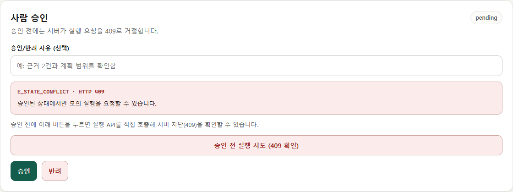
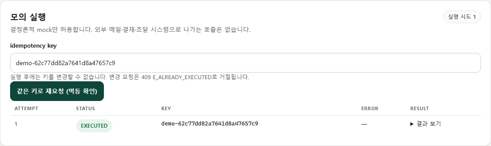

# Evidence-Gated Work Agent

> **LLM 없이 결정론적으로 동작하는 근거 게이트 워크플로 프로토타입입니다.** 공개 규정 요약 10건과 합성 fixture 4건, 고정 평가 EG-01~EG-14만 사용하며, 검색·계획 품질이나 실제 업무 자동화 성과를 주장하지 않습니다.

공개 행정규칙을 검색해 **근거가 통과해야만** 제한된 계획을 만들고, 사람 승인 뒤에만 결정론적 모의 실행을 수행하는 human-in-the-loop Agent 데모입니다. 핵심은 “계획을 잘 만드는 것”이 아니라 **근거 부족·상충·승인 전 실행을 서버에서 실제로 차단하고 그 이력을 남기는 것**입니다.

> **공개 데모 고지** — 실제 조달·메일·결재·파일 시스템을 실행하지 않습니다. LLM·외부 API·임베딩·벡터 DB를 호출하지 않습니다. 공개 호스팅의 SQLite는 재배포·재시작 시 초기화될 수 있으며 영속 감사 저장소로 주장하지 않습니다.

🌐 **[라이브 데모 열기](https://evidence-gated-work-agent.onrender.com/)** — Render Free 인스턴스는 유휴 상태 뒤 첫 요청에 초기 지연이 발생할 수 있습니다.

## 20초 요약

| | |
|---|---|
| **문제** | 승인 없는 실행, 근거 없는 계획, 실패 후 추적 불가를 한 흐름에서 막는 Agent 정책이 필요했다. |
| **구현** | 결정론 검색 → evidence gate → 제한 JSON 계획 → 사람 승인 → 멱등 mock 실행 → hash chain 감사 타임라인. |
| **검증** | `pytest` **151 passed**, 고정 평가 **14/14**, 네트워크·API 키 없이 재현. |
| **실행** | `python -m uvicorn app.main:create_app --factory --reload` → `http://127.0.0.1:8000` |

## 기존 두 프로젝트와의 차이

| 항목 | AI WorkPilot | Procurement Rules RAG Copilot | **이 프로젝트** |
|---|---|---|---|
| 중심 증거 | 승인·실행·감사 UI/상태 | 공개 규정 검색·인용·보류 | **근거 게이트가 계획 생성을 통제** |
| LLM/외부 호출 | LLM 어댑터 교체 지점 | 선택적 로컬 LLM·임베딩 | **없음 (결정론 only)** |
| 실행 | mock 도구 | 답변 생성/보류 | **승인 결속 멱등 mock + 자동 1회 재시도** |
| 데이터 | D1 | 수집 코퍼스 | **체크인된 소형 코퍼스 + 명시적 합성 fixture** |
| 핵심 차단 | 승인 전 실행 409 | 근거 부족 시 답변 보류 | **부족·상충이면 plans/approvals/executions 0행** |
| 감사 | 이벤트 타임라인 | 평가 리포트 | **append-only trigger + hash chain + seq** |

기존 두 저장소는 수정·병합하지 않는다. 각 저장소의 단일 책임과 이력을 유지하고, 이 프로젝트는 그 사이의 **정책 결합부**를 증명한다.

## 2분 데모

가장 빠른 확인(Docker):

```powershell
docker compose up --build -d
# http://127.0.0.1:8000
# 8000 포트 충돌 시: $env:EGWA_PORT="8010"; docker compose up -d
```

Python으로 실행:

```powershell
python -m pip install -e ".[dev]"
python -m uvicorn app.main:create_app --factory --reload
# http://127.0.0.1:8000
```

1. **① 충분 근거** — 공개 요약 2건이 통과해 `PENDING_APPROVAL`과 계획이 생성된다.
2. **승인 전 실행 시도 (409 확인)** — 승인 패널 안의 빨간 버튼을 누르면 서버가 `E_STATE_CONFLICT` 409를 반환하고 `executions`는 0행으로 남는다.
3. **승인 → 모의 실행** — `demo-reviewer` 승인이 계획 hash에 결속되고, mock 결과와 감사 타임라인이 생성된다.
4. **같은 키로 재요청 (멱등 확인)** — 신규 실행 없이 기존 결과가 반환되고 `replayed: true`가 표시된다.
5. **④ 실패 → 자동 재시도** — attempt 1 실패, attempt 2 성공이 타임라인에 남는다.
6. **② 부족 / ③ 상충** — 계획·승인·실행 버튼이 모두 막히고 사유가 표시된다.

| 승인 전 실행 409 (서버 강제) | 승인 후 모의 실행 |
|---|---|
|  |  |

> 스크린샷은 Playwright Chromium으로 실제 로컬 서버를 조작해 캡처했다(`scripts/e2e_browser.py`).

전체 API 흐름은 curl로도 재현할 수 있다.

```powershell
$run = Invoke-RestMethod -Method Post http://127.0.0.1:8000/api/runs `
  -ContentType "application/json" `
  -Body '{"request":"시설공사 계약보증금과 지연배상금 기준을 확인해 초안을 작성해줘","demo_mode":"none"}'
$run.run.run_id
$run.gate.public_valid_count
# 승인 전 실행 → 409
Invoke-WebRequest -Method Post "http://127.0.0.1:8000/api/runs/$($run.run.run_id)/executions" `
  -ContentType "application/json" -Body '{"idempotency_key":"demo-key-0001"}'
```

## 검증

```powershell
python -m pytest -o addopts="" -p no:cacheprovider
python -m evals.run_evals
```

| 검증 | 결과 | 산출물 |
|---|---|---|
| pytest | **151 passed / 약 7초** | unit 80 · integration 67 · concurrency 4 |
| 고정 평가 | **14/14** (dev 8, holdout 6) | `evals/results.json`, `evals/results.md` |
| 브라우저 E2E | **PASS** (Playwright Chromium) | `docs/demo-approval-409.png`, `docs/demo-execution.png` |
| 코퍼스 | 14문서 (공개 요약 10, 합성 fixture 4) | SHA-256 `9cecefc5…b16a9` |
| 환경 | Python 3.12.10, Windows, 네트워크·API 키 없음 | 2026-11-17 |

평가 케이스: 충분 근거, 부족 근거, 빈 질의, URL 누락, 낮은 점수, 상충, 승인 전 실행, 승인 뒤 실행, 2회 실패, 1회 실패→재시도, 중복 idempotency key, 계획 변조, 중복 승인, 반려.

## 핵심 불변조건 (테스트로 고정)

1. 게이트 미통과 run은 `plans`/`approvals`/`executions` **0행**.
2. 최소 인용은 **서로 다른 공개 문서 2개**이며 합성 fixture는 최소 인용 수에서 제외.
3. 검색 점수는 **절대값**(IDF 가중 coverage + BM25)이며 min-max 정규화를 쓰지 않는다.
4. 인용은 `https` + 허용 호스트 + 본문 부분일치 + **40자 이상** + 유효기간을 통과해야 한다.
5. 상충은 **태그된 `policy_key`/`policy_scope`/`policy_value`** 에서만 탐지한다(일반 의미 모순 탐지 아님).
6. 계획 hash는 NFC·정렬·구분자 고정 canonical JSON이며 **타임스탬프를 포함하지 않는다**. 근거 지문·게이트 설정 hash·코퍼스 hash·`PLAN_CREATED` 감사 앵커에 결속된다.
7. 승인은 계획 hash에 결속되고, 중복 승인은 409.
8. 실행은 `APPROVED` + 승인 기록 + hash 일치 + 근거 재검증을 모두 통과해야 한다. 승인 전 실행은 409.
9. 같은 idempotency key는 기존 결과를 반환하고, 다른 key는 409. 자동 재시도는 **최대 1회**, 2회 실패는 terminal.
10. 감사 이벤트는 `UNIQUE(run_id, seq)` + UPDATE/DELETE trigger + hash chain. 거부 요청도 감사에 남기되 run당 20건으로 상한.
11. SQLite는 연결마다 PRAGMA를 적용하고 `BEGIN IMMEDIATE`로 상태 검사·변경·감사를 한 트랜잭션에 묶는다.
12. 앱·테스트·평가 경로에 LLM·네트워크 호출이 없다(mock executor만 존재).

## 아키텍처

```text
업무 요청
  → Retriever (한국어 조사 제거 + 음절 bigram BM25)
  → EvidenceGate (점수·URL·발췌·유효기간·상충)
      ├─ 실패 → EVIDENCE_INSUFFICIENT (계획 없음)
      └─ 통과 → GatePass (frozen, gate만 발급)
                  → Planner (제한 JSON + canonical hash)
                  → 사람 승인 (plan hash 결속)
                  → MockExecutor (결정론, 부작용 없음)
                  → AuditLog (append-only + hash chain)
```

```text
DRAFT → RETRIEVING → EVIDENCE_INSUFFICIENT
                   ↘ PENDING_APPROVAL → APPROVED → EXECUTING → EXECUTED
                                      ↘ REJECTED             ↘ FAILED → RETRYING → EXECUTED / FAILED
```

```text
app/
  api/          FastAPI JSON routes + HTML pages
  domain/       상태 머신, GatePass, 레코드 모델
  services/     corpus, retrieval, evidence_gate, planner, execution, workflow, audit
  templates/    단일 흐름 데모 화면
  static/       vanilla JS/CSS (외부 CDN 없음)
data/public_corpus/
  documents.json, SOURCES.md
evals/
  cases.json, run_evals.py, results.json, results.md
tests/
openspec/changes/build-evidence-gated-work-agent/
Dockerfile, docker-compose.yml, render.yaml
```

## API와 오류 계약

| 메서드 | 경로 | 설명 |
|---|---|---|
| `POST` | `/api/runs` | 요청 생성 + 검색 + 게이트 + 계획 |
| `GET` | `/api/runs/{run_id}` | run 전체 상태·근거·계획·승인·실행·감사 |
| `POST` | `/api/runs/{run_id}/approval` | `approve` 또는 `reject` |
| `POST` | `/api/runs/{run_id}/executions` | idempotency key로 mock 실행 |
| `GET` | `/health` | DB·코퍼스·설정 hash·버전 |

주요 오류 코드: `E_STATE_CONFLICT`(409), `E_PLAN_HASH_MISMATCH`(409), `E_EVIDENCE_STALE`(409), `E_CONFIG_CHANGED`(409), `E_CORPUS_CHANGED`(409), `E_ALREADY_EXECUTED`(409), `E_RETRY_LIMIT`(409), `E_IN_PROGRESS`(409), `E_VALIDATION`(422), `E_SENSITIVE_INPUT`(422), `E_BODY_TOO_LARGE`(413), `E_RATE_LIMITED`(429), `E_NOT_FOUND`(404).

`approved_by`, `status`, `plan_hash`, `attempt` 등 서버 소유 필드는 요청 모델에서 `extra="forbid"`로 거부한다.

## 데이터와 한계

- **공개 문서 10건**은 국가법령정보센터 조달청 행정규칙의 제목·URL과 **검토용 요약 발췌**다. 원문을 복제하지 않았고 법적 효력을 주장하지 않는다. 이용 근거는 저작권법 제7조 제2호이며 상세는 [`data/public_corpus/SOURCES.md`](data/public_corpus/SOURCES.md).
- **합성 fixture 4건**은 상충·유효기간 만료·URL 누락을 검증하기 위한 자료이며 실제 조달 기준이 아니다. UI에서 `합성 fixture` 배지로 구분한다.
- **상충 탐지**는 `policy_key`가 태그된 문서에 한정된다. 점수 0.30 이상으로 드러난 정책 키에 대해 코퍼스 전체를 스캔하지만, 일반 문서의 의미적 모순을 탐지하지 않는다.
- **URL 검증**은 구조·도메인 allowlist 검사이며 원문 페이지를 실시간으로 가져오지 않는다. 원문 최신성은 보증하지 않는다.
- **검색 품질**은 LLM/RAG 성능이 아니라 재현 가능한 회귀 계약이다. 코퍼스가 작아 일반 조달 질의 성능으로 일반화할 수 없다.
- **SQLite**는 로컬 데모 저장소다. Render Free에서는 재배포·유휴 종료 시 **소실될 수 있으며(ephemeral)**, 감사 로그의 hash chain은 **변조 탐지 보조**이지 서버 관리자에 대한 tamper-proof 보장이 아니다.
- **인증 없음**. `run_id`는 128-bit UUID이고 IP당 rate limit이 있지만, 공개 데모의 승인은 실제 신원 인증이 아니다.

## Docker / Render

```powershell
docker compose up --build -d
# http://127.0.0.1:8000/health
# 8000 포트 충돌 시: $env:EGWA_PORT="8010"; docker compose up -d
```

- **검증 완료:** Docker 29.9.3에서 빌드·기동, `Up (healthy)`, non-root `uid=10001(appuser)`, `/health` 200(schema 1, WAL, 14문서), `/docs/verification` 200, 충분/부족/상충/승인 전 409/멱등 replay API 흐름 통과. 상세는 [`docs/verification.md`](docs/verification.md).
- 컨테이너는 non-root UID, `HEALTHCHECK`, `--factory` 실행을 사용한다.
- Compose에는 **영속 volume을 두지 않았다**. 데모 이력이 영속 운영 DB라고 오해되지 않게 하기 위함이다.
- Render Free 배포는 `render.yaml`을 참고한다. `EGWA_DB_PATH=/tmp/evidence_gated.db`이며 재시작 시 초기화된다.

## 문서

- [전문가 A/B/C 인터뷰·교차 검증 원장](docs/interview-decisions.md)
- [아키텍처와 정책 불변조건](docs/architecture.md)
- [소스 맵과 라이선스 확인](docs/source-map.md)
- [한국어 검색 설계와 ablation](docs/retrieval.md)
- [검증 기록 (pytest·평가·Docker)](docs/verification.md)
- [고정 평가 결과](evals/results.md)
- [OpenSpec change](openspec/changes/build-evidence-gated-work-agent/proposal.md)

## 채용 역량 → 구현 증거

| 역량 | 증거 |
|---|---|
| Agent 정책 설계 | `GatePass` 없이는 planner 호출 불가, 상태 전이표 단일화 |
| 백엔드 안전성 | 승인 전 실행 409, plan hash 검증, CAS 전이, `BEGIN IMMEDIATE` |
| RAG 근거 통제 | 절대 점수 게이트, URL/발췌/유효기간/상충 검사, 합성 fixture 분리 |
| 데이터 모델링 | runs/evidence/plans/approvals/executions/audit_events + unique 제약 |
| 관측성 | seq 연속 감사, hash chain, 거부 요청 감사, `/health` |
| 오류 처리 | 멱등 재실행, 자동 1회 재시도, terminal 실패, stale run reconcile |
| 제품/UX | 2분 단일 흐름, 차단 사유·409 JSON 노출, 접근성 라벨·CSP |
| 검증 문화 | 151 tests, 14 고정 평가, negative-path 우선, 오프라인 재현 |

## 라이선스

새 코드는 MIT License다. 기준 저장소 두 개에는 검토 시점 `LICENSE` 파일이 없었으므로 **소스 코드를 복사하지 않았고**, 구조·테스트 아이디어·공개 메타데이터만 참고했다. 자세한 내용은 [`docs/source-map.md`](docs/source-map.md)를 따른다.
